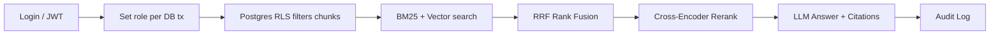

# Role-Based Access Control for Retrieval-Augmented Generation (RBAC RAG)

This project restricts document retrieval in a retrieval-augmented generation (RAG) system by user role. Access is enforced at the PostgreSQL database layer, not through LLM system prompt instructions or application-level filtering.

## How It Works

A user logs in and receives a JWT containing their assigned role. For each query, the backend opens a PostgreSQL transaction under a restricted application user and sets the session variable `app.current_user_role` to the role from the verified token. PostgreSQL Row-Level Security (RLS) filters the `allowed_roles` array on chunk rows, so only authorized chunks are visible to the search steps that follow.

Retrieval then runs over those authorized chunks only:
- Vector search uses pgvector similarity inside the RLS-enforced transaction.
- BM25 ranking runs in Python (`rank_bm25`) over the chunks that RLS allows for that role.

The two ranked lists are merged with Reciprocal Rank Fusion (RRF), re-ordered with a cross-encoder reranker, and passed to an LLM to generate an answer with bounding-box citations. The query and retrieved chunk IDs are written to an audit log.



## Tech Stack

- Backend: FastAPI (Python 3.11+, developed on 3.13)
- Frontend: React 19, TypeScript, Vite, Tailwind CSS
- Database: PostgreSQL 16 with pgvector and Row-Level Security
- Cache: Redis 7 (role-scoped query cache and live user role/status checks for revocation)
- Models: BAAI/bge-base-en-v1.5 (embeddings), cross-encoder/ms-marco-MiniLM-L-6-v2 (reranking), gpt-4o-mini (classification and generation)

## Key Design Choices

- **Database-enforced RLS:** Access policies run inside PostgreSQL via a per-transaction session setting (`set_config(..., true)`), so a bug in application code is less likely to expose restricted rows. The setting resets when the transaction ends, so a role does not carry over between pooled connections.
- **Identity from the JWT only:** The role is read from the verified token and checked against live user state in Redis (with a PostgreSQL fallback), so revoking a user takes effect without waiting for the token to expire. Role claims written inside a user prompt are ignored.
- **Role-scoped query cache:** Cached responses are stored under `rag_cache:{role}:{hash of normalized query}`. This is an exact-match cache (lowercased, whitespace-normalized query text), not a semantic similarity cache. The role prefix prevents one role from receiving an answer cached for another.
- **Human review step for tagging:** Automated chunk classification flags blocks with confidence below 0.90 for manual review and role editing in the UI before publishing.
- **Audit logging:** Each query logs the user, active role, query text, timestamp, and retrieved chunk IDs to PostgreSQL and to markdown log files.

## Evaluation

Evaluations used a synthetic corpus of 7 documents (199 pages, 380 chunks) and 70 golden test queries. Because the dataset is small and synthetic, the results show that the access control and retrieval pipeline behave as designed under these test conditions. They do not show that the approach holds up on real-world data or against every attack.

### Retrieval Ablation (70 Queries)

| Retrieval Mode | Recall@5 | MRR@5 | p95 Latency | Unauthorized Chunks |
| :--- | :---: | :---: | :---: | :---: |
| `bm25_only` | 0.8857 | 0.7469 | 35.68 ms | 0 |
| `vector_only` | 0.8143 | 0.6433 | 95.74 ms | 0 |
| `hybrid_rrf` | 0.8714 | 0.7024 | 127.29 ms | 0 |
| `hybrid_rerank` | 0.9286 | 0.7686 | 2215.52 ms | 0 |

- **Cross-role isolation:** 165 queries from one role targeting another role's documents; 0 of 825 retrieved chunks were unauthorized.
- **Adversarial prompts:** 60 prompts covering direct unauthorized access, role spoofing, indirect prompt injection, and cache probing; no data leaks were observed. The prompts were written by the author, so this is a sanity check and not an independent security audit.

## Limitations

- **Small synthetic dataset:** Tested only on 7 synthetic PDF documents. Noisy, scanned, or complex tabular documents have not been evaluated.
- **Single-role sessions:** One active role per user. No role hierarchy (senior roles inheriting junior permissions) and no multi-role membership.
- **Fixed role definitions:** The set of allowed roles (`engineering`, `hr`, `finance`, `all_employees`, `admin`) and their access rules are defined in the database schema and RLS policies rather than dynamically created at runtime. User role assignments can be modified via the admin API (`PUT /api/v1/auth/admin/update-role`), but new role types cannot be added without updating the database scripts.
- **BM25 does not scale as built:** For each query, all chunks authorized for the role are loaded into memory and scored in Python. This is fine for a few hundred chunks but would need a database-side or dedicated search index for a larger corpus.
- **Exact-match cache:** Paraphrased questions do not hit the cache.
- **Reranker latency:** The cross-encoder accounts for most of the response time (p95 about 2.2 s vs about 127 ms for hybrid RRF).
- **Ingestion in request handlers:** Parsing and embedding run inside the API request, not in a background job queue.
- **Limited tests:** The test suite covers each build phase with a small number of tests and does not cover every edge case.

## Setup and Run

Requirements: Docker, Python 3.11+, Node.js, and an OpenAI API key (used for document tagging and answer generation).

Demo accounts (admin, hr, engineering, finance, intern) are created only when SEED_DEMO_USERS=true. They are for local use only. Set it to false and remove DEMO_PASSWORD in any shared or deployed environment.

### 1. Database and Cache
```bash
cd rbac-rag-backend
docker compose up -d
```

### 2. Backend
```bash
cp .env.example .env
# Set LLM_API_KEY and JWT_SECRET_KEY (generate with the command in .env.example)

python -m venv .venv
source .venv/bin/activate  # On Windows: .venv\Scripts\activate
pip install -r requirements.txt
uvicorn backend.main:app --reload --port 8000
```
The database schema and RLS policies are applied when the server starts.

### 3. Frontend
```bash
cd ../rbac-rag-frontend
npm install
npm run dev
```
The interface is available at `http://localhost:5173`.

Demo personas for local login (the password comes from `DEMO_PASSWORD`; `.env.example` sets `DemoPass123!`, which the demo UI expects):
- Admin: `admin@company.com`
- HR: `priya.hr@company.com`
- Engineering: `arjun.eng@company.com`
- Finance: `vikram.fin@company.com`
- Intern: `neha.intern@company.com`

### 4. Tests and Evaluations
The tests and evaluation scripts need PostgreSQL and Redis running, and some also need `LLM_API_KEY` set. The evaluation scripts expect the sample documents to be ingested first.
```bash
cd ../rbac-rag-backend
pytest
python evaluation/run_ablation_eval_v2.py
python evaluation/run_cross_role_eval_v2.py
python evaluation/run_red_team_v2.py
```

## Project Structure

```
.
├── rbac-rag-backend/
│   ├── backend/
│   │   ├── auth/         # JWT handling, live role/status checks
│   │   ├── db/           # PostgreSQL connection, schema, RLS policies
│   │   ├── generation/   # Prompt building, LLM client, citations, audit logging
│   │   ├── ingestion/    # PDF parsing, auto-tagging, chunking, embedding
│   │   ├── models/       # Pydantic request and response schemas
│   │   ├── retrieval/    # BM25, vector search, RRF fusion, reranking, cache, guardrails
│   │   └── routers/      # FastAPI routes (auth, chat, ingest)
│   ├── evaluation/       # Benchmark scripts, golden dataset, result logs
│   └── tests/            # Pytest test suites
├── rbac-rag-frontend/
│   └── src/              # React components (chat, persona switcher, PDF viewer, admin)
└── RAG_EVAL_TESTING/
    └── Documents/        # 7 synthetic PDF documents used for evaluation
```