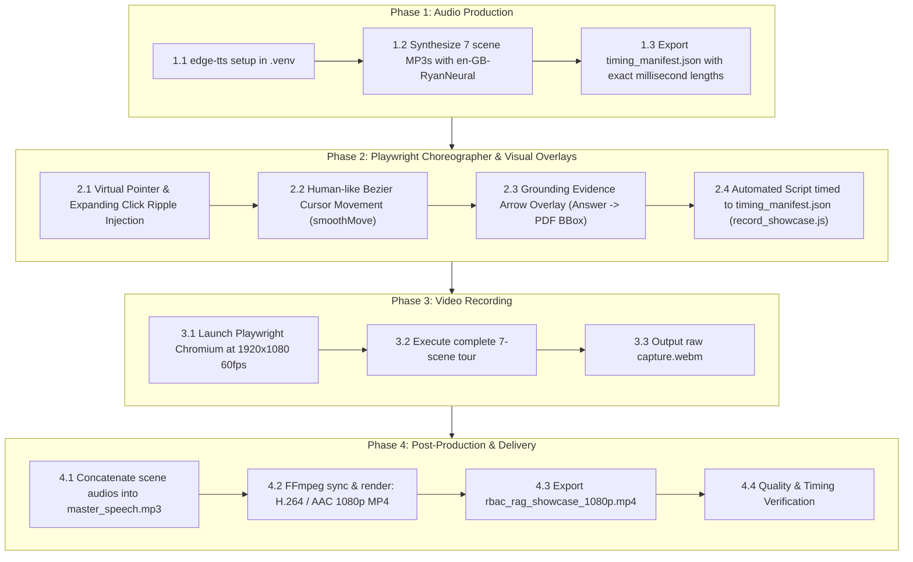

# Automated Showcase Video Production Implementation Plan

## Goal Description
Create a high-impact, professional, application-focused demonstration video (approx. 85–95 seconds) for **RBAC RAG Core**. 

The narrative is structured around **four real-world enterprise headaches** that typical RAG implementations fail to handle, showing exactly how our application solves each one cleanly in the UI, backed by our **evaluation benchmark numbers**.

---

## Narration Voice & Tone Configuration
* **Voice**: Microsoft Neural **`en-GB-RyanNeural`** (British English, calm, natural, unhurried professional tone).
* **Tone**: Grounded, engineering-practical, and product-first. No exaggerated "breakthrough" claims.
* **No Library Names**: "PyMuPDF" is not mentioned in the voiceover; it is described naturally as the *"document inspector with highlighted bounding box evidence"*.

---

## Complete Video Script & Storyboard

### Scene 1: Opening Hook & The "Day One Curiosity" Problem
* **Duration**: ~14 seconds
* **Route / Screen**: `/login` (Persona Selection Grid)
* **Visual Actions**: 
  - Browser opens at `http://localhost:5173/login`.
  - Visible virtual pointer moves smoothly across the demo persona cards (HR, Engineering, Finance).
  - Hovers briefly over Priya Patel (HR), highlighting her role badge.
  - Clicks Priya's card to sign in and seamlessly redirect to `/chat`.
* **Voiceover Script (`en-GB-RyanNeural`)**:
  > *"Let’s be honest: the very first thing someone is going to ask an internal company chatbot is how much their colleagues are earning.*  
  > *When confidential salary sheets and general policies live in the same database, relying on system prompts saying, 'please don’t tell them' usually lasts about five minutes.*  
  > *Here is a look at how this application handles role-based access across enterprise documents."*

---

### Scene 2: High-Caliber Query on Multi-Role Strategic Document
* **Duration**: ~18 seconds
* **Route / Screen**: `/chat` (Priya Patel - HR)
* **Document Used**: `Meridian_Q3_Strategic_Review_And_All_Hands_Briefing_2025.pdf` (Multi-role document containing HR, Finance, Engineering, and Company-wide sections).
* **Enterprise Prompt**:
  > *"What were the senior leadership compensation adjustments and retention bonuses approved in the Q3 Strategic Review?"*
* **Visual Actions**:
  - Cursor enters the query into the chat input and clicks Send.
  - The 7-stage pipeline card steps through: *Identity & Access Verification &rarr; Document Retrieval &rarr; Reranking &rarr; Response Synthesis*.
  - The assistant generates a structured response detailing leadership compensation adjustments (VP of Engineering Neha Sharma ₹42L base + ₹5L bonus, Head of Product Rajesh Nambiar ₹38.5L base, VP of Finance Vikram Singhania ₹44L base) with verified citation cards.
* **Voiceover Script (`en-GB-RyanNeural`)**:
  > *"Most tutorials show demonstrate basic application-layer filters, meaning a single backend bug can leak confidential files. Here, permissions are enforced directly by PostgreSQL Row-Level Security.*  
  > **As Priya from HR, she asks about a multi-department strategic report. The system checks her access permissions and retrieves only the information she's allowed to see, along with relevant citations."*

---

### Scene 3: Visual Document Evidence & Arrow Proof of Non-Hallucination
* **Duration**: ~16 seconds
* **Route / Screen**: `/chat` (Citation Inspection Slide-Over Drawer with Visual Arrow Overlay)
* **Visual Actions**:
  - Cursor moves to the citation card and clicks it.
  - The slide-over inspection drawer smoothly opens on the right, displaying the original multi-role document on Page 12.
  - Shows the **Multi-Role Color Legend** (`Red: HR Only`, `Purple: Finance Only`, `Blue: Engineering Only`, `Green: All Employees`).
  - **Visual Arrow / Connector Overlay**: A clean glowing SVG arrow with bracket lines animates on screen, connecting the synthesized salary numbers on the left chat bubble directly to the Red bounding box outlining the exact table on the PDF on the right.
  - Proves to the viewer that the answer is 100% grounded and not hallucinated.
  - Cursor hovers over the coordinates, then clicks the close button (`X`).
* **Voiceover Script (`en-GB-RyanNeural`)**:
  > *"Another big challenge in enterprise AI is compliance. Security teams need clear evidence to trust the answers.*  
  > *Clicking a citation opens our document inspector. Notice how every figure in the answer traces directly to the highlighted bounding box on the original document page, visually confirming zero hallucination across multi-role files."*

---

### Scene 4: The Side-by-Side Test — Zero Data Leakage
* **Duration**: ~18 seconds
* **Route / Screen**: `/compare` (Dual Persona Split-Screen)
* **Visual Actions**:
  - Cursor moves to sidebar item "Comparison" and clicks to navigate to `/compare`.
  - Cursor selects the test prompt: *"What is the compensation for Staff Engineers?"*.
  - Clicks "Run Comparison".
  - Left pane (HR) returns the full salary breakdown.
  - Right pane (Engineering) returns a polite access denial: *"I do not have access to that information in the documentation available for your role."*
* **Voiceover Script (`en-GB-RyanNeural`)**:
  > *"What happens when an engineer asks that exact same question?*  
  > *In our side-by-side comparison, identical prompts execute simultaneously. HR receives the full compensation table, while the database completely suppresses restricted records for the engineering role. Zero prompt leakage, zero unauthorized retrieval."*

---

### Scene 5: Real-World Headache #3 — The Stale Token Vulnerability
* **Duration**: ~15 seconds
* **Route / Screen**: `/admin/security` (Role Revocation Command Center)
* **Visual Actions**:
  - Cursor navigates to "Security" in the sidebar (`/admin/security`).
  - Cursor moves to the button **"Run 1-Click Revocation Proof"** and clicks it.
  - Live benchmark execution runs: Step A (HR query works), Step B (Role demoted to Engineering), Step C (Same unexpired session token fired again & blocked in <1ms).
* **Voiceover Script (`en-GB-RyanNeural`)**:
  > *"Another common vulnerability in web applications is stale authentication tokens. If an employee changes roles, or if someone's access is revoked, their existing token usually retains access for hours.*  
  > *Here, active entitlements are validated in Redis in under one millisecond. The moment permissions are updated or revoked, access cuts off on the very next request."*

---

### Scene 6: Concrete Evaluation Benchmark Results (Visual Scorecard UI)
* **Duration**: ~14 seconds
* **Route / Screen**: `/eval` (Dedicated Evaluation & Benchmarks Dashboard)
* **Visual Actions**:
  - Cursor clicks "Evaluation" in the navigation sidebar, transitioning to the dedicated `/eval` Benchmark Dashboard.
  - The camera focuses on the sleek, high-contrast evaluation dashboard displaying:
    - **Hero Metric Tiles**: 
      - **92.9% Recall@5** (`hybrid_rerank` vs 81.4% `vector_only`)
      - **0.769 MRR@5**
      - **100% Cross-Department Isolation** (0 leaks in 825 chunks inspected)
      - **60/60 Red-Team Attacks Blocked** (100% containment)
    - **Interactive Retrieval Ablation Bar Chart**: Visual comparison bars contrasting `hybrid_rerank` (92.9%), `bm25_only` (88.6%), `hybrid_rrf` (87.1%), and `vector_only` (81.4%).
    - **Cross-Role Containment Matrix**: A 4x4 role isolation grid with glowing green shields showing 0.0% leakage.
    - **Red-Team Defense Cards**: Four category pills detailing defense mechanisms (PostgreSQL RLS, JWT Live Auth, Regex Guardrails, Role-Scoped Redis Keys).
  - Cursor smoothly highlights the 92.9% Recall card and the zero-leak containment badge as the narration states the numbers.
* **Voiceover Script (`en-GB-RyanNeural`)**:
  > *"In benchmark evaluations across nearly two hundred pages of enterprise documentation and seventy real-world queries, our hybrid retrieval pipeline achieved 92.9% recall, with a 100% isolation rate across cross-department tests, and zero leaks under adversarial prompt injection."*

---

### Scene 7: Outro & Wrap-Up
* **Duration**: ~6 seconds
* **Route / Screen**: Overview / Clean Chat Interface
* **Visual Actions**:
  - Cursor glides back to the main workspace.
  - Smooth fade to black.
* **Voiceover Script (`en-GB-RyanNeural`)**:
  > *"A practical, reliable approach to enterprise document intelligence. Thanks for watching."*

---

## Technical Production Pipeline

---

## Verification Plan

### Automated Verification
1. **TTS Audio Generation**: Run `python scripts/generate_voiceover.py` &rarr; verify all 7 MP3s play cleanly with Ryan's British voice.
2. **Timing Manifest**: Verify `scripts/timing_manifest.json` matches total runtime (~90 seconds).
3. **Playwright Execution**: Run `node scripts/record_showcase.js` &rarr; verify 0 errors, smooth transitions, and successful `.webm` video write.
4. **FFmpeg Compilation**: Verify final `recordings/rbac_rag_showcase_1080p.mp4` format (1920x1080, 60fps, AAC audio, under 40MB).

### Manual Verification
1. Play the final MP4 in Chrome / VLC.
2. Confirm cursor leads every click naturally.
3. Confirm voiceover narration stays in sync with on-screen actions.
4. Verify the 4 real-world headache callouts and evaluation metrics are clearly audible and visible.